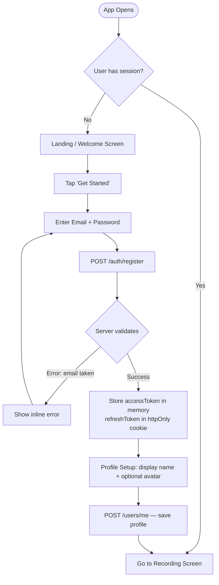
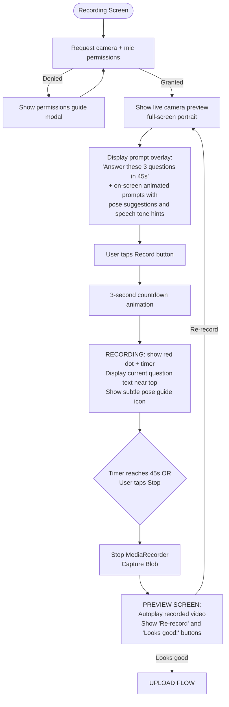
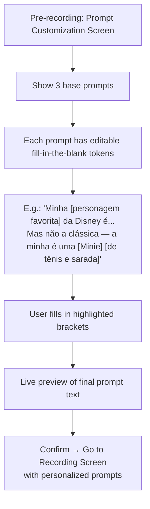
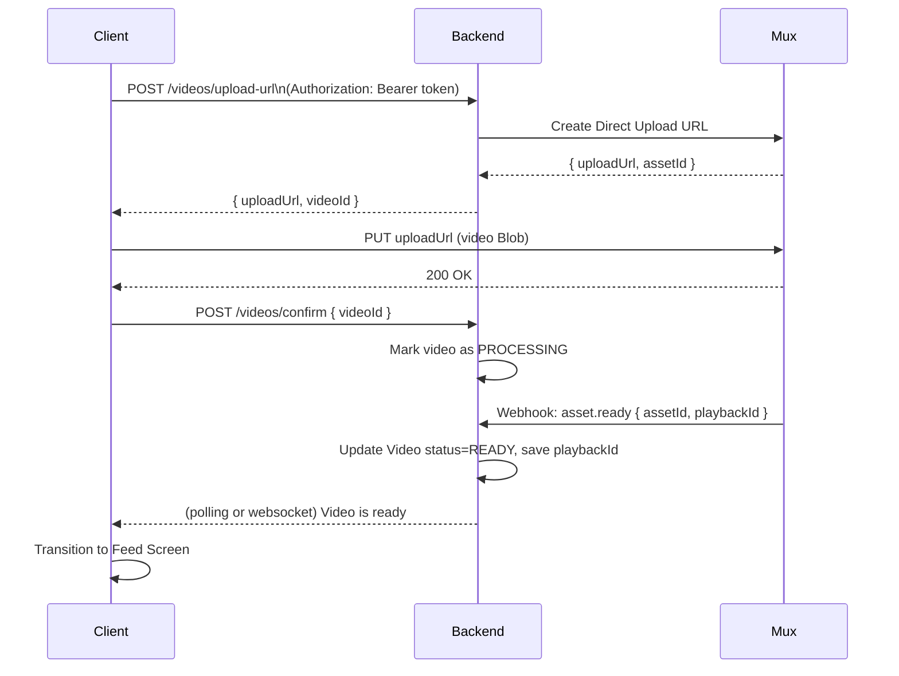
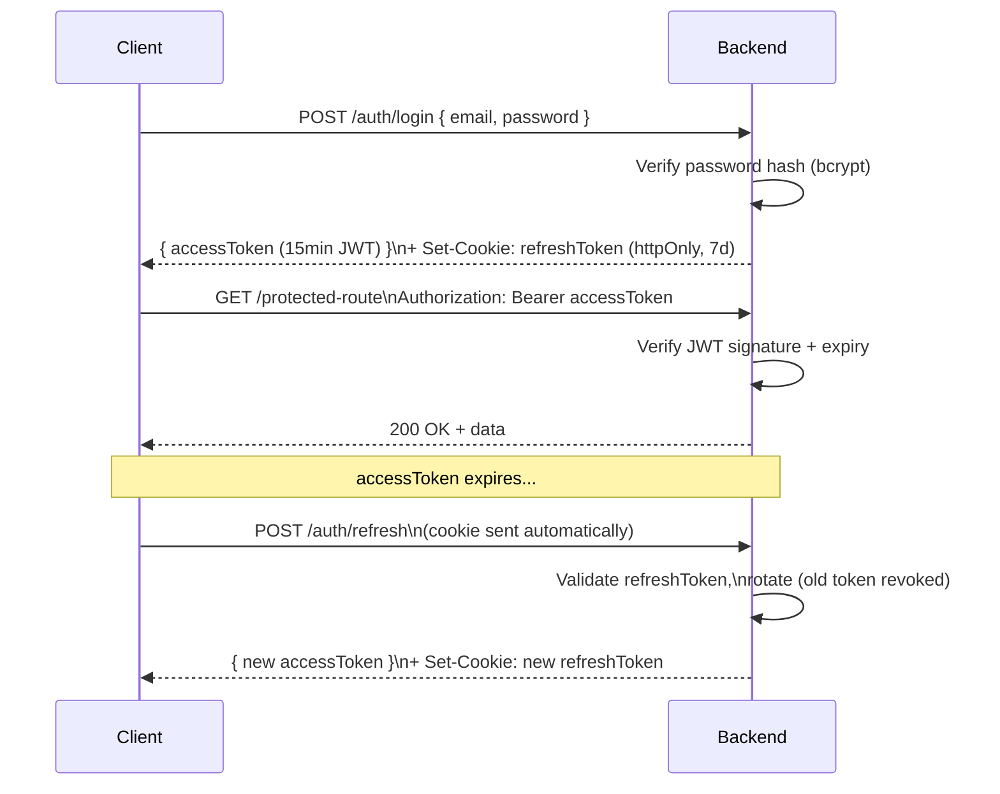
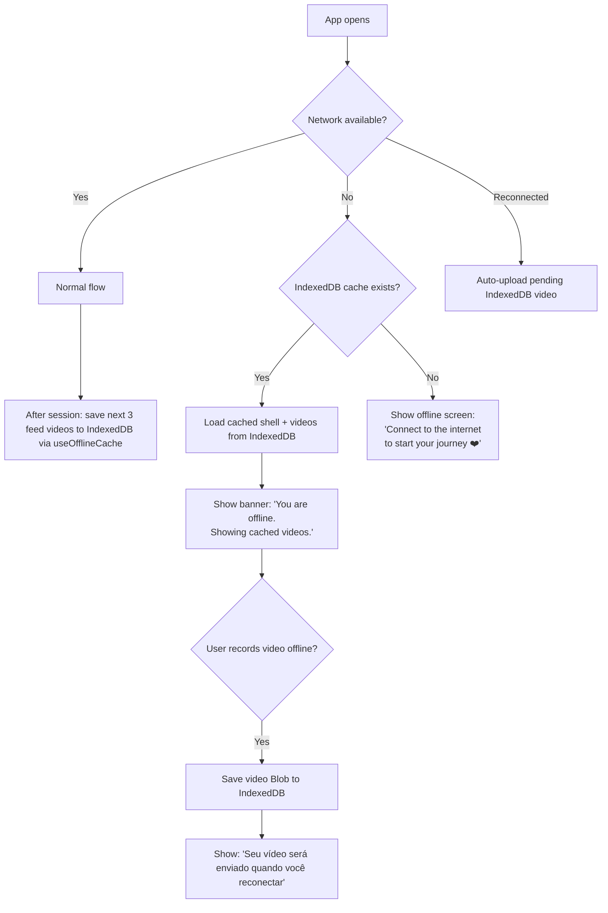
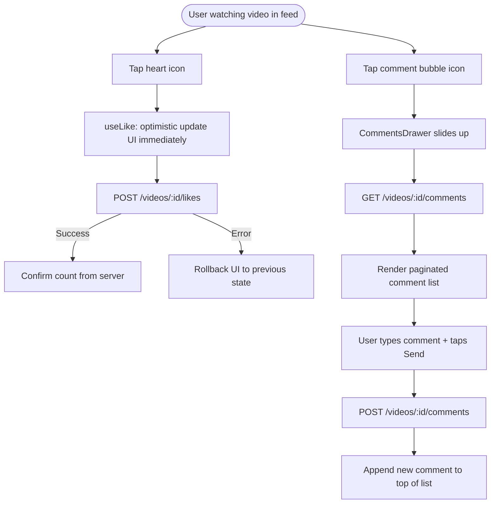
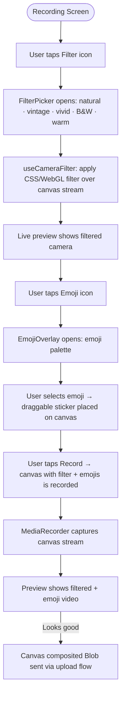
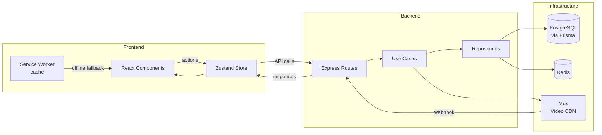

# Flows — Speed Dating App

> This document describes every significant user journey and system flow.  
> Update this file whenever a flow is added or changed. Diagrams use Mermaid syntax.

---

## 1. User Registration & Onboarding



---

## 2. Video Recording Flow (Core Feature — v1)



### 2.1 On-Screen Recording Assistance (v1 — Shame Barrier Reduction)

The overlay system shown during recording:

```
┌────────────────────────────────┐
│  [Q1 of 3] 0:12 / 0:45  ●REC   │  ← top bar
│                                │
│  💡 "Lean slightly forward     │  ← pose hint (fades in/out)
│      and smile naturally"      │
│                                │
│  [Camera live view]            │
│                                │
│  🗣 "Minha personagem favorita │  ← current prompt text
│     da Disney é..."            │  ← (large, readable near camera)
│                                │
│  💬 Tone: warm & playful ✨   │  ← tone suggestion
└────────────────────────────────┘
```

Prompt Sequence:
1. **0–15s** — "Minha personagem favorita da Disney é..." (pose: relaxed, slight lean forward)
2. **15–30s** — "Se eu pudesse dominar uma habilidade instantaneamente..." (pose: hands expressive, tilt head)
3. **30–45s** — "Minha tarde livre perfeita parece com..." (pose: big smile, open posture)

### 2.2 Customizable Prompt System (v1)

Users can personalize their prompts before recording:



---

## 3. Video Upload Flow



---

## 4. Feed / Video Pool Flow

```mermaid
flowchart TD
    A([Feed Screen]) --> B[GET /feed]
    B --> H{Videos found?}
    H -- No --> I["Show friendly empty state:<br/>'Be the first! Your video is<br/>awaiting its first match.'"]
    H -- Yes --> C[Autoplay first video full-screen]
    C --> D{Video ends?}
    D --> E[Show subtle swipe-up hint]
    E --> F[User swipes up OR auto-advance]
    F --> G[Play next video\n(prefetch already loaded)]
    G --> D
```

### 4.1 Feed Sequencing Algorithm (v1 — Simplified)

In v1, the sequence is: **recency-based** (newest uploads first), deduped per session.

```
feedAlgorithm_v1(userId):
  1. Fetch videos WHERE status=READY AND userId != currentUser
  2. Exclude videos already seen by currentUser in this session
  3. Order by createdAt DESC
  4. Return paginated list (10 at a time)
  5. Cache result in Redis: feed:pool:{userId} TTL=5min
```

---

## 5. Authentication Token Flow



---

## 6. Offline / Cold Start Flow (v1 — Completo)



**Estratégia de cache por tipo:**
| Recurso | Estratégia | Armazenamento |
|---|---|---|
| App shell (HTML/CSS/JS) | Cache-first | Service Worker Cache API |
| Metadata de vídeos | Network-first, fallback cache | Service Worker Cache API |
| Blobs de vídeo (até 3) | Pre-fetch após sessão | IndexedDB (`offline-videos`) |
| Vídeo gravado offline | Store on record | IndexedDB (`pending-uploads`) |

---

## 7. Like & Comment Flow



---

## 8. Filters & Emoji Overlay Flow



---

## 9. Error Flows

### 7.1 Upload Failure
```
Upload fails (network error / Mux error)
→ Show retry modal with attempt count
→ Max 3 retries with exponential backoff
→ After 3 failures: "Algo deu errado. Seu vídeo foi salvo localmente. Tente de novo mais tarde."
→ Store video blob in IndexedDB for retry
```

### 7.2 Permission Denied (Camera/Mic)
```
Browser blocks camera permission
→ Show step-by-step guide (browser-specific) to enable permissions
→ Deep link to browser settings where supported
```

### 7.3 Video Too Long (client-side enforcement)
```
MediaRecorder hits 45s limit
→ Automatically stops recording
→ Proceeds to preview (no user action needed)
→ Timer UI shows warning at 40s (last 5 seconds highlighted red)
```

---

## 10. Data Flow Overview


